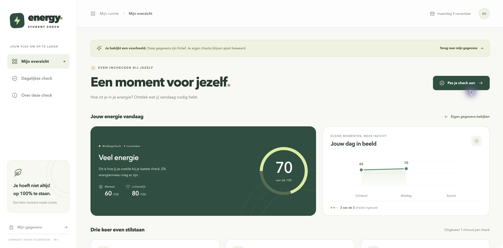
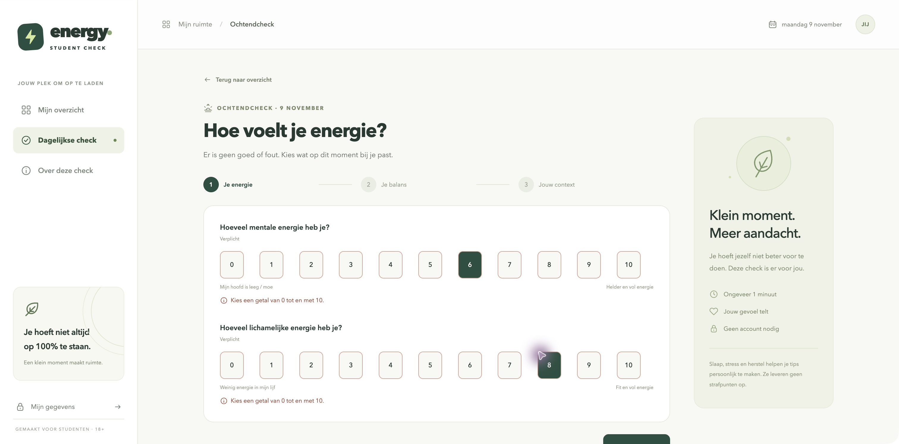
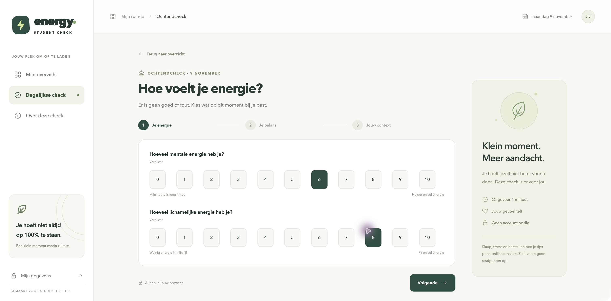
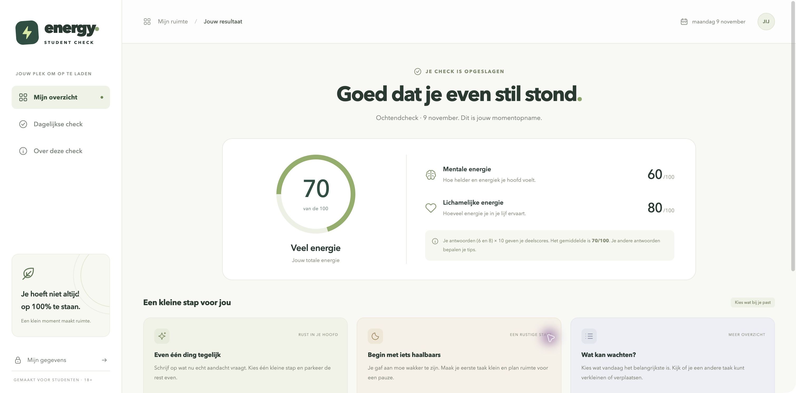

# Week 1 — Student Energy Check

**Datum:** 9 november 2026. **Gebruikte AI-tool:** Codex.

## Wat hebben we gedaan?

We begonnen met een briefing voor een energiechecker met slaap, stress, sport, een dashboard en tips. Daarna stelde de AI vragen om het idee duidelijker te maken. We kozen studenten van 18+, drie checkmomenten per dag en aparte mentale en lichamelijke scores.

Twee gebruikte instructies uit het gesprek:

> Kun je nu vragen stellen zodat we elkaar zeker weten goed begrijpen

Dit is een fragment uit de verduidelijkingsvraag.

> Begin met fase 1. Maak agents.md eerst

De eerste werkende versie bevat de drie checks, scores, tips en lokale opslag.

## Wat hebben we getest en verbeterd?

Bij het testen klikten we eerst op Volgende zonder antwoorden. De app gaf terecht een foutmelding. Daarna kozen we geldige antwoorden, maar de meldingen bleven staan. Dat hebben we aangepast: ze verdwijnen nu direct zodra het antwoord geldig is. Dezelfde test is daarna opnieuw uitgevoerd.

Ook hebben we gecontroleerd dat antwoorden 6 en 8 een totaalscore van 70 opleveren. De veertien bestaande automatische tests slagen.

## Vier screenshots

1. **Dashboard:** de werkende app met duidelijk gemarkeerde voorbeeldgegevens.

2. **Vóór de verbetering:** 6 en 8 zijn gekozen, maar de foutmeldingen staan er nog.

3. **Na de verbetering:** dezelfde antwoorden, de opgeloste meldingen zijn weg.

4. **Resultaat:** mentale energie 60 en lichamelijke energie 80 geven samen 70.

De opnames zijn tijdens deze testsessie gemaakt met fictieve gegevens. Alleen de browserbalk is weggesneden. De promptfragmenten zijn achteraf uit het gesprek overgenomen.

**Nog zelf aanvullen:** wat heb jij hiervan geleerd en wat vond je van het werken met deze tool?

Voeg de gekozen screenshots later rechtstreeks als afbeeldingen in de PowerPoint in.
